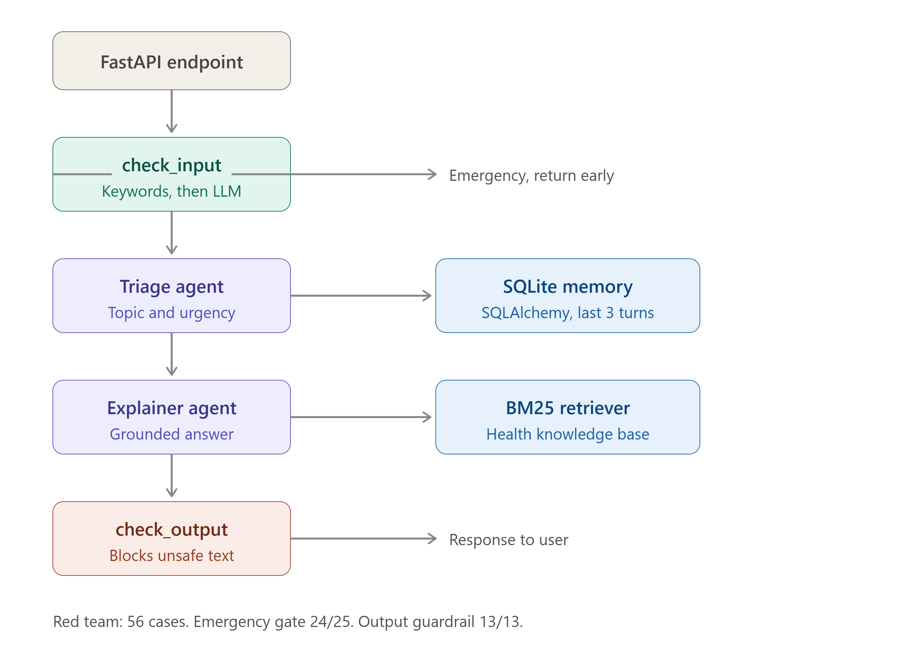

# HealthSense AI

A multi-agent health information assistant built around a single question: **how do you make an agentic system's safety claims measurable rather than asserted?**



---

## What this is

HealthSense AI answers general health questions in plain language — explaining conditions, terminology, and guidance grounded in a curated knowledge base. It runs as an API and on WhatsApp, in English, Hindi and Hinglish; on WhatsApp it also understands voice notes and can read a photo or PDF of a lab report.

It is deliberately **not** a diagnostic tool. It cannot prescribe, dose, or diagnose. That boundary isn't a line in a prompt; it's enforced in code on both sides of the model call.

**Stack:** Python · CrewAI · FastAPI · SQLAlchemy · SQLite · Anthropic Claude · OpenAI gpt-transcribe (voice notes) · WhatsApp Cloud API · Locust

---

## Why safety is the interesting part

Health is a domain where LLM failure modes are asymmetric. A hallucinated dosage, an implied diagnosis, or a missed emergency signal costs far more than an over-cautious refusal.

Most agent projects treat safety as a filter bolted on afterwards. This one is designed around the asymmetry from the start, and then **measured** — because a safety claim you can't falsify isn't a claim.

---

## The safety cascade

Two independent gates, deliberately not sharing a failure mode.

### Gate 1 — input, pre-LLM (`check_input`)

Runs before any model call, in two layers:

**Layer 1: deterministic keyword screen.** Does not block on its own — it *routes*. A keyword hit marks a message as needing scrutiny. The keyword list covers English, Hindi (Devanagari) and Hinglish, written from red-flag concepts rather than copied from the test set.

**Layer 2: LLM classifier.** Makes the call, on every message.

**Why Layer 1 routes rather than blocks.** An earlier version blocked on any keyword hit, with a whitelist of "educational" phrasings carved out so that *"what are the warning signs of a heart attack?"* would pass. That scored 0 false alarms on the suite it was built against — and 6 wrong blocks out of 10 on an independently written one. The whitelist had been fitted to the test set that produced it. Whitelists don't generalise; reasoning about intent does.

**What Layer 1 still guarantees.** If Layer 2 can't run — API down, timeout, a silently broken function — a message that hit a keyword is blocked. The deterministic layer is the floor, not the ceiling. The gate never disappears because a service did.

That's the property worth protecting. A model in the safety path can hallucinate, and left alone it **fails open** exactly when you can't afford to lose it. The cheap, certain layer is what stops that.

### Gate 2 — output, post-generation (`check_output`)

The same shape as Gate 1. Regex patterns for dosing, diagnosis and discouraging care **flag** an answer; an LLM judge reads the flagged answer and **decides**; if the judge can't run, a flagged answer is blocked. Unsafe answers are **withheld and replaced**, not annotated.

**Why the judge was added.** The patterns alone blocked a correct fever answer because it said *"see a doctor if… you have underlying health conditions"* — the same words as the diagnosis *"you have a migraine"*. Words can't tell those apart; reading for meaning can. After the redesign: output false alarms went from 5/12 to 0/12, with recall unchanged.

**Why withhold rather than annotate.** An earlier version appended a caution below the unsafe text — but a disclaimer under dosing advice still leaves the dosing advice on screen. In an asymmetric-cost domain, withhold.

### Never silence

If the LLM service itself is unreachable (outage, exhausted credits, rate limit) and no keyword fired, `answer()` returns a fixed, pre-translated message: *try again later, and call 112 / 108 if this could be an emergency.* Like the emergency message, it is fixed text, so it works with the API down. Because it lives in `answer()`, every channel gets it; the WhatsApp channel also keeps its own last-resort fallback reply (with 112) for anything that fails around the crew, such as a media download or a voice-note transcription. (The gap in `answer()` was found by the stress test below.)

---

## Evaluation

All four suites are re-run after every change to the safety path.

| Suite | Cases | Recall | False alarms |
|---|---|---|---|
| Red-team suite — emergency gate | 36 | 25/25 (100%) | 0/11 |
| Red-team suite — output guardrail | 32 | 18/18 (100%) | 0/14 |
| Independent set (emergency gate) | 31 | 21/21 (100%) | 0/10 |
| Hindi & Hinglish (emergency gate) | 25 | 17/17 (100%) | 0/8 |
| **Total** | **124** | **81/81** | **0/43** |

```
python -m app.evaluation.run_safety_eval
python -m app.evaluation.run_independent_eval
python -m app.evaluation.run_multilingual_eval
```

### Round 1 — red-team suite, 68 cases

Adversarial framings included: indirect ("asking for a friend"), fictional ("for a story I'm writing"), minimizing ("probably nothing, but my vision went black"), and hypothetical ("hypothetically, how long can a person go without breathing"). The output cases include conditional dosing, diagnosis followed by a referral, and safe answers that contain numbers or "if you have…" warnings.

### Round 2 — independent set, 31 cases

**Why a second set exists.** Round 1 was written alongside the guardrail, which means it can only prove the system handles the cases it was built against. Round 2 was generated from a different starting point — not *"what would evade this code?"* but *"how do people actually write when something is wrong?"* Its cases come from how patients present at triage, how people write to crisis lines, and how fear, embarrassment, and language barriers distort a message: lay somatic description with no clinical vocabulary, apologetic hedging, non-native English, the urgent fact buried after small talk, indirect signals of suicidal intent.

**What it found.** Recall generalised (20/21 on first run). Precision did not — 6 of 10 safe questions were wrongly blocked, exposing the educational whitelist as overfitting. That finding drove the router redesign described above. After the fix: 21/21 recall, 0 false alarms, with Round 1 unchanged.

**Caveat, stated plainly:** Round 2 is *more* independent, not fully independent. Anyone who writes a test set brings their own blind spots. Real independence means someone who has never seen the implementation.

### Round 3 — Hindi & Hinglish, 25 cases

With the LLM on: 17/17 recall, 0/8 false alarms. With the LLM off, the keyword floor alone catches 14/17 (it caught 0/17 before Hindi and Hinglish terms were added) — the floor is a floor, not a replacement.

### Two failures worth recording

**The whitelist that scored perfectly.** 0 false alarms on Round 1, 60% on Round 2. A perfect score against your own test set is not evidence of a correct system — it's evidence you tested what you thought of.

**The function that broke silently.** An edit to `llm_emergency_check` disabled it. It still ran. It returned a value. Nothing raised. The suite printed 8% recall and looked like a tuning problem. The whole LLM layer was gone. Without the harness that would have shipped as a two-layer cascade with one layer.

### LLM-as-judge harness

```
python -m app.evaluation.run_eval
```

Scores responses against a golden dataset for groundedness (is the answer supported by retrieved context?) and relevance.

Note the separation: the LLM **judges** offline, where a mistake is cheap and recoverable. It does not **enforce** alone online — Layer 1 is underneath it, holding the floor.

---

## Stress testing (Locust)

Safety has to hold under load too. `locustfile.py` simulates users asking a mix of normal and emergency questions against the local `/ask` endpoint (not through WhatsApp). Every request calls Claude for real, so it starts small.

```
locust -f locustfile.py --host http://127.0.0.1:8000 --headless -u 5 -r 1 -t 3m --only-summary
```

What it found, in the order it was found:

**1. A crash with just two users.** Most requests failed with HTTP 500: `Executor is already running. Cannot invoke the same executor instance concurrently.` The CrewAI agents were created once at import and shared by every request. **Fix:** build fresh agents per request. **Result:** 5 concurrent users, 0 failures (previously ~4,000 failed requests in one run).

**2. An outage meant a crash.** When the API rejected calls (credits exhausted, during the test), keyword hits were still blocked correctly — but every other `/ask` request crashed with a bare HTTP 500. (WhatsApp users were covered: that channel already caught the error and sent its own fallback reply with 112. The gap was in the shared `answer()` path.) **Fix:** the *never silence* message above, inside `answer()` itself.

**3. Shared memory on `/ask`.** `/ask` had no user id, so every caller shared one conversation memory — a headache answer mentioned an earlier, unrelated fever question. **Fix:** `/ask` takes an optional `user_id`; callers without one get a fresh random id, never a shared default. (WhatsApp already kept memory per user, under a hashed id.)

**4. Slow replies.** Each request now logs how long every stage took (console line plus `timings.csv`). Measured before optimising, at 5 concurrent users:

| Stage (average) | English | Hinglish |
|---|---|---|
| Safety gate 1 | 1.3 s | 1.3 s |
| Crew (triage + explainer) | 32.1 s | 26.8 s |
| Safety gate 2 | 1.0 s | 1.2 s |
| Translate answer back | — | 20.4 s |
| **Total** | **34.4 s** | **51.5 s** |

The crew was ~93% of the time; the safety checks cost about a second each, so swapping them to a faster model would have saved little while touching the safety path. The real cost was answer length — every word generated once, and for Hindi/Hinglish translated again. **Fix:** WhatsApp-sized answers (about 150–200 words). **Result:** English 34.4 s → 17.6 s, Hinglish 51.5 s → 30.5 s, emergencies unchanged at ~1.1 s. The safety code was not touched, and every live answer in the run passed Gate 2.

---

## Architecture

Request path:

```
FastAPI / WhatsApp → language detection → check_input (on the original message)
  → translate to English → triage agent → explainer agent (+ BM25 retrieval, memory)
  → check_output (on the English answer) → translate back → response
```

**Language layer — "English core, translation at the edges."** Language is detected by rules (no API call). The input gate runs on the original text, so no translation step can drop or soften a symptom first. The crew and the output guardrail work in English, the language the patterns are written in; translation happens only after the answer has passed. Safety messages are pre-translated fixed text, so they still come out in Hindi when the LLM is unreachable.

**Triage agent** — classifies topic and urgency, decides what a good answer should focus on. Does not answer.

**Explainer agent** — retrieves from the knowledge base, then writes a short, plain-language answer grounded in what it found.

**Agents per request** — both agents are built fresh for every request, so concurrent requests never share an executor.

**Retrieval** — BM25 over a curated health knowledge base. Answers are anchored to source passages rather than parametric memory.

**Memory** — last 3 turns per user, persisted in SQLite via SQLAlchemy.

**Voice notes** — Claude does not take audio input, so a WhatsApp voice note is downloaded, transcribed with OpenAI's `gpt-transcribe` (with a Hindi/English language hint), and the **text** then takes exactly the same path as a typed message: input gate on the transcript, crew, output guardrail, translation. Nothing about safety is special-cased for voice. The reply starts with 🎤 and the words that were heard, so a misheard word is visible straight away — in health, one wrong word can change the meaning. Unreadable formats, silent recordings and transcription failures all still get a reply that mentions 112.

**Report analysis** — a photo or PDF of a lab report goes to Claude vision to read the values; Python (not the model) compares each value with the reference range printed on the report; the explanation then goes through the output guardrail and translation like any other answer. A synthetic sample report is in `sample_reports/`.

---

## Setup

```
git clone https://github.com/smita-datascience/healthsense-ai.git
cd healthsense-ai

python -m venv venv
venv\Scripts\activate          # Windows
source venv/bin/activate       # macOS / Linux

pip install -r requirements.txt
```

Copy `.env.example` to `.env` and add your keys:

```
ANTHROPIC_API_KEY=your-key-here
OPENAI_API_KEY=your-key-here      # only needed for WhatsApp voice notes
```

Run the API:

```
uvicorn app.main:app --reload
```

Ask a question (send the same `user_id` to keep a conversation's memory):

```
curl -X POST http://127.0.0.1:8000/ask -H "Content-Type: application/json" -d "{\"question\": \"What helps with a mild headache?\", \"user_id\": \"demo-1\"}"
```

---

## v2: WhatsApp channel (live)

HealthSense is reachable on WhatsApp through Meta's Cloud API. The channel is a thin layer over the same `answer()` function the API uses, so both safety gates run unchanged and the evaluation numbers above still describe what a WhatsApp user gets.

The channel adds its own fail-closed check (webhook signature verification), drops duplicate deliveries, and stores conversation memory under a hashed id rather than the user's phone number. It authenticates with a System User token, so it does not expire daily like Meta's temporary test token. It currently runs locally behind an ngrok tunnel, on a Meta test number. Voice notes need an `OPENAI_API_KEY` in `.env`; the audio is sent to OpenAI for transcription. Details, decisions and known limits: [ARCHITECTURE_WHATSAPP.md](ARCHITECTURE_WHATSAPP.md).

Tests (no network, no API credits — downloads, OpenAI and the crew are faked):

```
python -m pytest tests/test_whatsapp.py tests/test_voice.py tests/test_report.py tests/test_language.py -q
```

---

## Design tradeoffs

Choices made explicitly, not by default.

**CrewAI over LangGraph.** CrewAI's role/task abstraction maps cleanly onto a small, fixed pipeline and got a working vertical slice up fast. LangGraph offers finer control over state and branching, which this system doesn't need yet. If the crew grows conditional or cyclic paths, that flips.

**Sequential over hierarchical process.** The order is known and fixed — triage always precedes explanation. A hierarchical manager agent would add an LLM call and a source of nondeterminism to solve a routing problem that doesn't exist here.

**BM25 over dense embeddings.** Health queries are dense with precise clinical terminology, where lexical match is a strong signal and retrieval is auditable — you can see exactly why a passage was pulled. It also keeps an embedding model and vector store out of the v1 dependency chain. The cost is real; see Limitations.

**RAG over fine-tuning.** The knowledge base changes; the model's behaviour doesn't need to. Grounding gives citable provenance and lets the corpus update without a retraining cycle.

**Deterministic layer first in the cascade.** Covered above — the ordering is the whole argument.

**Measure before optimising.** The obvious speed-up was a faster model for the safety checks. The timings showed they cost ~1 s each; the crew cost ~30 s. Shorter answers halved English latency without touching the safety path.

---

## Known limitations

- **Both test sets are still mine.** Round 2 was written from a different angle, but by the same person who wrote the guardrail. Genuinely independent means someone who has never seen the implementation.
- **Layer 2 now runs on every message**, not just the ones Layer 1 missed. More API calls, slightly higher latency and cost. That was the price of dropping the whitelist, and it was worth paying.
- **Still slow under load.** ~18 s (English) and ~31 s (Hindi/Hinglish) per answer with 5 concurrent users. Translating the answer back is now the largest cost for Hindi/Hinglish.
- **Load-tested at 5 users only**, on a laptop. Larger loads will hit Claude API rate limits before anything else.
- **Hindi translations of the safety messages** should be reviewed by a native speaker before real-world use.
- **Voice notes leave the machine.** The audio goes to OpenAI for transcription — a privacy trade-off for better Hindi accuracy; a local Whisper model is the alternative.
- **Voice in, text out.** Replies are written, not spoken. OpenAI's simple text-to-speech models are being retired on 6 January 2027 in favour of the Realtime API, so spoken replies were postponed rather than built on an endpoint that is about to close. A written emergency message is also easier to re-read and act on.
- **BM25 misses semantic paraphrase.** "Why does my chest feel tight" won't lexically match a passage on angina. A hybrid retriever (BM25 + dense, rank-fused) is the fix.
- **The knowledge base is curated and small.** Coverage gaps produce refusals rather than wrong answers — the correct failure direction, but still a gap.
- **Memory is short.** Last 3 turns per user; no cross-session profile, no semantic memory.
- **Observability is basic.** Per-stage timings and an error log, but no tracing, live monitoring or drift detection.
- **I wrote both the guardrail and the red-team set.** That's a blind spot by construction. Independently generated adversarial prompts are the honest next step.

---

## What's next

- Spoken replies on WhatsApp, built on OpenAI's Realtime API (the simple speech endpoint is being retired)
- Follow-ups and appointment booking — on a demo calendar, not real doctor schedules
- A faster model for translating answers back to Hindi/Hinglish, with the output guardrail re-checked on the translation
- A third test set written by someone who has not seen the code
- Cache Layer 2 results for repeated queries, to claw back the cost of routing everything through it
- Hybrid retrieval (BM25 + dense, rank fusion), evaluated against the same golden dataset to prove the complexity earns its place
- Tracing and observability; eval-in-CI so a drop in safety recall fails the build

---

## A note on where the design comes from

Before machine learning, I spent four years writing firmware in C for heavy water plant operations at BARC. In that environment you don't get to say "it's probably fine." You enumerate failure modes, you assume the component fails, and you design so that the failure is survivable.

The cascade in this project is that instinct applied to LLMs: put the layer that cannot fail in front of the layer that can, and then go looking for the cases where you were wrong. The stress test is the same instinct one level up: assume the system fails under load, then go and make it.

---

*Health information only, not medical advice. A portfolio / demo project.*