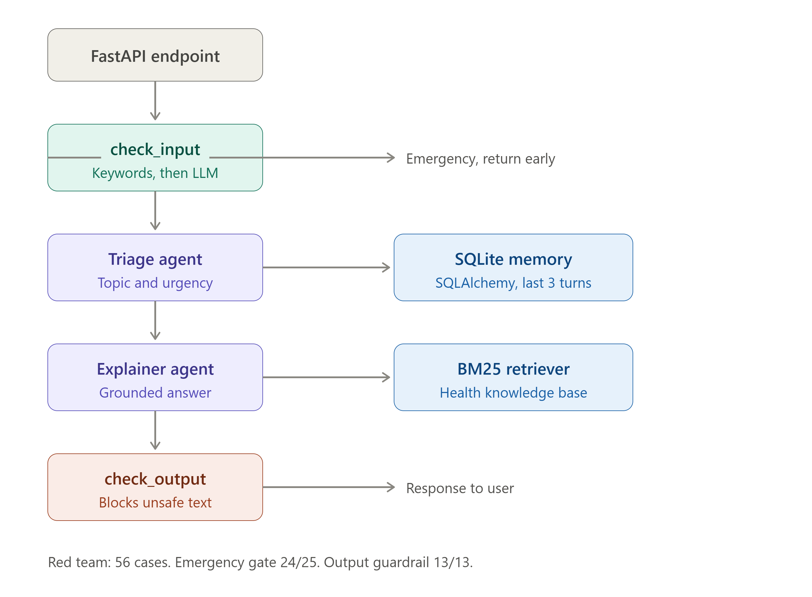

# HealthSense AI


A multi-agent health-information assistant built with CrewAI, LangChain, FastAPI, and Anthropic Claude. A user's question passes through a safety gate, a triage agent, and an explainer agent that grounds its answer in a knowledge base via RAG — with conversation memory throughout, served as a documented API.

> **Not a medical device.** HealthSense AI provides general health information only, not diagnosis or medical advice.

---

## What it does
## Key features

- **Multi-agent orchestration** — a triage agent assesses each question and hands its read to an explainer agent (CrewAI, sequential process).
- **Retrieval-Augmented Generation (RAG)** — the explainer searches a health knowledge base and grounds answers in retrieved facts rather than parametric memory.
- **Conversation memory** — every turn is persisted; recent turns are fed back so follow-up questions resolve against context.
- **Safety guardrails** — a deterministic emergency screen runs *before* the model; urgent inputs bypass the agent and route to real help.
- **Documented API** — FastAPI with an interactive `/docs` interface.

## Tech stack

| Area | Choice |
|---|---|
| Orchestration | CrewAI |
| LLM | Anthropic Claude |
| API | FastAPI |
| Data / memory | SQLAlchemy + SQLite (MySQL-ready via one env var) |
| Retrieval | Keyword search over a health knowledge base |

## Architecture
## Getting started

```bash
# 1. environment
python -m venv .venv
.venv\Scripts\activate          # Windows

# 2. install
pip install -r requirements.txt

# 3. configure
copy .env.example .env          # add your ANTHROPIC_API_KEY

# 4. run
uvicorn app.main:app --reload
```

Then open **http://127.0.0.1:8000/docs** and try the `/ask` endpoint.

## Design decisions

- **Low temperature (0.2)** — caution and consistency for a health domain, plus reliable structured tool calls.
- **Two specialist agents** over one — focused prompts, easier to debug and improve; the extra LLM call is justified because assessing and answering are distinct jobs.
- **Safety as a deterministic gate before the model** — an LLM can't be trusted to police itself; emergency inputs never reach the agent.
- **SQLite by default, MySQL by one env var** — zero-setup dev, production-ready via `DATABASE_URL`.

## Roadmap

- [x] Phase 1 — Core build: multi-agent crew, memory, RAG, safety
- [ ] Phase 2 — Hardening: evaluation (faithfulness/safety), observability, trained-classifier guardrails
- [ ] Phase 3 — Deployment + advanced RAG (embeddings + vector DB + reranking)

## Limitations

Current retrieval uses keyword matching (misses semantic synonyms — the reason to move to embeddings). Safety is a keyword screen (production needs a trained classifier and output guardrails). No formal evaluation layer yet — planned for Phase 2. Health data handling would require PII minimization before real-world use.